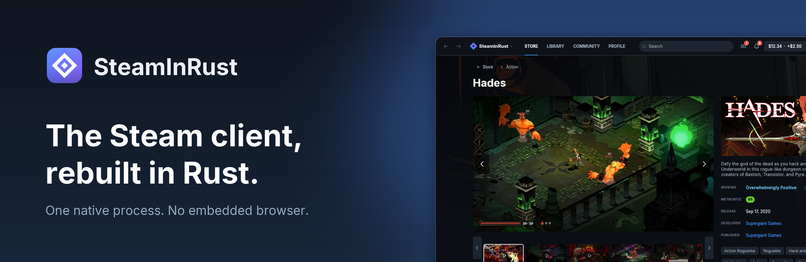
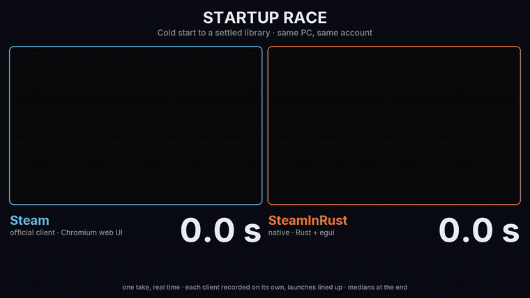

<p align="center">
  
</p>

<p align="center">
  <a href="#download"><b>Download</b></a> ·
  <a href="#performance"><b>Benchmarks</b></a> ·
  <a href="docs/parity.md"><b>Parity</b></a> ·
  <a href="docs/steam-compatibility.md"><b>Games and anti-cheat</b></a> ·
  <a href="CONTRIBUTING.md"><b>Contributing</b></a> ·
  <a href="README.ru.md"><b>Русский</b></a>
</p>

<p align="center">
  <a href="https://github.com/madonchik123/SteamInRust/releases/latest"></a>
  <a href="https://github.com/madonchik123/SteamInRust/actions/workflows/ci.yml"></a>
  
  
</p>

# SteamInRust

**The Steam desktop client, rewritten in Rust.** Store, library, downloads,
friends, chat, inventory, Market, Steam Cloud and the Shift+Tab overlay, in one
native process with no embedded browser. It signs in to your own Steam account
and talks to Steam's servers directly. Free, open source (MIT) and unofficial.

The official client is a Chromium app: a dozen `steamwebhelper.exe` processes
drawing web pages. SteamInRust draws everything itself on the GPU with
[egui](https://github.com/emilk/egui), so it starts in about two seconds and
idles at a quarter of a gigabyte.

<p align="center">
  
</p>

## What works today

Everything below is in the current release. Area-by-area status:
[parity](docs/parity.md).

- **Store.** Front page, search, tags with filters, wishlist and cart. Game
  pages play trailers natively. Prices are in your wallet's currency, and games
  you own are marked. You can gift a game, even one you own, and SteamInRust
  checks first whether Steam will deliver it to that friend's region. Payment
  happens on Steam's website, as Steam requires.
- **Library.** Every game you own, collections (your Steam Favorites and Hidden
  included), non-Steam games, filters, achievements and full Properties:
  launch options, language, betas, DLC, Steam Cloud, verify files.
- **Downloads.** SteamInRust's own depot downloader. It has a queue, pause and
  resume, and downloads that survive a restart. It shows network and disk
  speed separately, and picks the fastest of Steam's download regions.
- **Friends and chat.** Live status with the game and rich presence, chat with
  history, and a separate Friends window. Right-click a friend to join their
  game or look up their server.
- **Community.** Profiles, comments, game hubs, Workshop pages, guides and
  discussions, all inside the app.
- **Inventory and Market.** Every game's inventory, market prices, order book and
  price chart. Selling uses Steam's real fees; you confirm in the Steam Mobile app.
- **Steam Cloud.** Sync before you play and after you quit, conflicts with
  local backups, and saves made offline upload once you're back online.
- **Games.** Games without anti-cheat get achievements, stats, cloud saves,
  lobbies and P2P from SteamInRust's own `steamclient`, 32-bit games included.
  Games with VAC, Easy Anti-Cheat or BattlEye always start through the official
  client, silently, so their anti-cheat runs as intended
  ([how](docs/steam-compatibility.md)).
- **Overlay.** Shift+Tab in the running game opens friends, chat,
  achievements, guides and notes. Like Steam's, it's drawn inside the game
  (D3D11 games), so it works in full screen. You can pin any of them over the
  game.
- **Offline mode.** It works like Steam's. If the connection drops, SteamInRust
  reconnects without signing you out, and your running games keep going.
- **Plugins.** Small [Rhai](https://rhai.rs) scripts can add pages,
  notifications and automations, with only the permissions you approve.
- **English and Russian**, picked from your system language.

<table>
  <tr>
    <td width="50%"></td>
    <td width="50%"></td>
  </tr>
  <tr>
    <td width="50%"></td>
    <td width="50%"></td>
  </tr>
</table>

<sub>Screenshots from <code>--demo</code> mode, which uses sample account data.</sub>

## Performance

**SteamInRust opens its window about 4 times sooner than Steam and uses about
a fifth of the memory**, on the same PC, account and network. Measured on
8 November 2026 on a Ryzen 5 5600 with 16 GB of RAM, Windows 11, SteamInRust
v0.1.0 against Steam 11.15.70.27. Both clients started on the library. Every
figure is the median of 5 runs:

| | Steam | SteamInRust |
| --- | ---: | ---: |
| Start → main window | 10.6 s | 2.4 s |
| Start → library fully drawn | 20.5 s | 8.1 s |
| Memory when idle (private bytes) | 1,130 MB | 245 MB |
| CPU when idle | 8 % of a core | 0.03 % |
| Processes | 8 | 1 |
| Program size | 1,083 MB | 25.5 MB |
| Open a game page in the library | 0.89 s | 0.03 s |
| Open Friends & Chat | 1.31 s | 0.06 s |

Opening the Store takes about as long in both (1.19 s and 1.01 s), because
both wait on Steam's servers. Most of SteamInRust's 8.1 s was library art
arriving over the network. Images are now cached on disk, so later starts
don't wait for them. Method, ranges and what was left out:
[docs/benchmarks.md](docs/benchmarks.md).

## Download

Get it from [the latest release](https://github.com/madonchik123/SteamInRust/releases/latest):

| File | What it is |
| --- | --- |
| `SteamInRust-Setup-<version>.exe` | Installer. Installs for your user only, without administrator rights, into `%LOCALAPPDATA%\Programs\SteamInRust`, and updates itself |
| `SteamInRust-<version>-portable.zip` | The same app with no installer. Doesn't update itself |
| `SHA256SUMS.txt` | Checksums for both |

Needs Windows 10 or 11 (64-bit) and a Steam account. Sign in with your password
and Steam Guard, or scan the QR code with the Steam Mobile app. Windows
SmartScreen may warn about a new unsigned app: **More info → Run anyway**.
Uninstall from **Settings → Apps**.

## Is it safe to use?

- **Your account.** SteamInRust signs in the way the official client and the
  Steam Mobile app do. Your sign-in stays on your PC, in your user's app data
  folder, and is only sent to Steam.
- **Anti-cheat.** SteamInRust never touches anti-cheat. Games that use it
  always run through Valve's client.
- **Other connections.** Apart from Steam, the app only contacts GitHub (for
  updates) and an exchange-rate service (when you check a gift's region). If
  you add your own key, it also contacts IsThereAnyDeal (price history). There
  is no telemetry.
- **Not official.** SteamInRust isn't made or approved by Valve.

## Plugins

A plugin is a folder with a manifest and a script. This one adds a page that
counts your online friends:

```toml
# plugins/friends-online/plugin.toml
id = "friends-online"
name = "Friends online"
version = "1.0.0"
permissions = ["friends.read"]

[page]
title = "Friends online"
icon = "users"
```

```rust
// plugins/friends-online/main.rhai
fn page() {
    let online = friends().filter(|f| f.status != "Offline");
    [
        #{ type: "heading", text: "Friends online" },
        #{ type: "stat", label: "Right now", value: online.len().to_string() },
    ]
}
```

Scripts can't reach files, the network or other programs, only the API they
were granted. The API is in [`crates/plugins`](crates/plugins/src/lib.rs), with
more examples in [`crates/plugins/examples`](crates/plugins/examples).

## Build from source

Needs [Rust](https://rustup.rs) and MinGW-w64. The project uses the GNU
toolchain (see `rust-toolchain.toml`).

```sh
git clone https://github.com/madonchik123/SteamInRust.git
cd SteamInRust
cargo run                  # sign in with your account
cargo run -- --demo        # sample data, no sign-in
cargo test --workspace
cargo xtask steamclient32   # the DLL for 32-bit games (needs a 32-bit MinGW)
cargo xtask package        # installer and portable zip in target/package/dist
```

<details>
<summary>How the code is laid out</summary>

```
apps/desktop     the app: window, sign-in, overlay, tray, updater, pages (builtin/)
apps/installer   installer, updater and uninstaller
xtask            release packaging (cargo xtask package)
crates/
  client         the engine: commands in, events out; PICS, chat, cloud, market
  net            connection to Steam: WebSocket, framing, jobs, service calls
  auth           sign-in: RSA password, QR, Steam Guard, refresh tokens
  depot          depot downloader
  steamclient    the steamclient DLL that games load
  store          store APIs: browse, reviews, tags, trailers, news
  video          trailer player: HLS, Media Foundation, WASAPI
  local          the Steam folders on disk: libraries, manifests, verify
  plugins        Rhai plugins
  extensions     the interface every page implements
  i18n           translations (locales/ru.toml)
  ui             theme, fonts, widgets
  proto          Steam's .proto files, compiled with protox
  vdf, model     KeyValues parser, shared types
```
</details>

## Contributing

Issues and pull requests are welcome. Read [CONTRIBUTING.md](CONTRIBUTING.md)
first. Pull request titles follow Conventional Commits (`feat: …`, `fix: …`),
since that's how releases and the changelog are made. Areas that still need
work are in [docs/parity.md](docs/parity.md).

## Project status

| Area | Score |
| --- | ---: |
| Sign-in and accounts | 0.75 |
| Offline mode and reconnecting | 1 |
| Library | 0.75 |
| Downloads and installs | 0.75 |
| Store | 0.75 |
| Friends and chat | 0.75 |
| Community | 0.5 |
| Inventory and Market | 0.75 |
| Steam Cloud | 1 |
| Steam features inside games | 0.75 |
| Shift+Tab overlay | 0.75 |
| Notifications and tray | 1 |
| Settings, languages, updates | 0.75 |
| Big Picture, Remote Play, Steam Input | 0 |

0 is not started, 1 is complete. What's missing in each area:
[docs/parity.md](docs/parity.md).

## Credits

Fonts: [Inter](https://rsms.me/inter/) (OFL). Icons: [Phosphor](https://phosphoricons.com) (MIT).
Protocol definitions: [SteamDatabase/Protobufs](https://github.com/SteamDatabase/Protobufs).
Price history: [IsThereAnyDeal](https://isthereanydeal.com).

## License

[MIT](LICENSE). Steam and the Steam logo are trademarks of Valve Corporation.
SteamInRust is not affiliated with, endorsed or sponsored by Valve.
