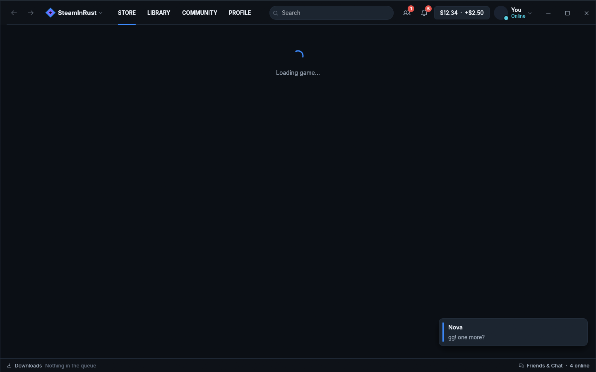
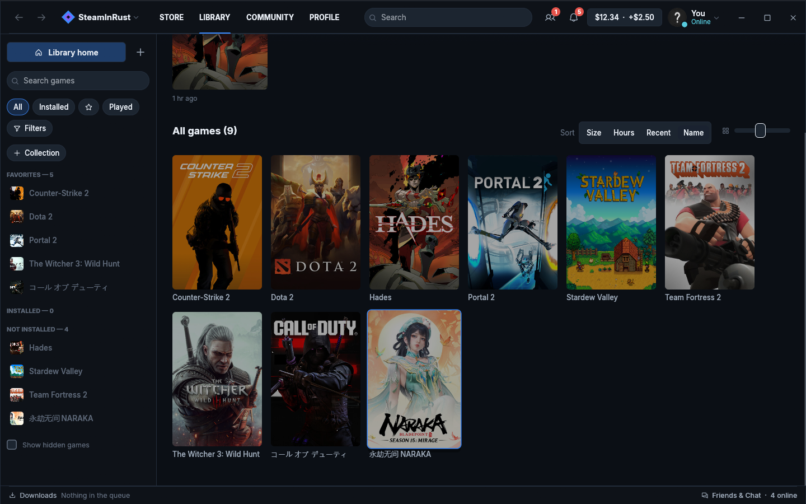
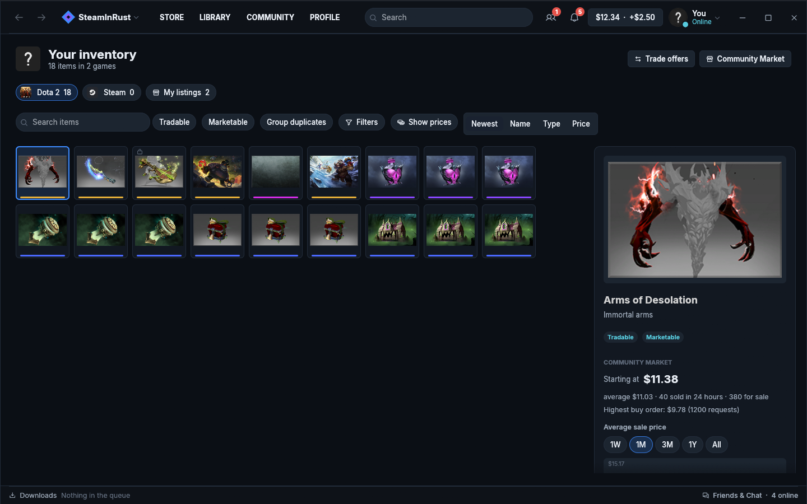
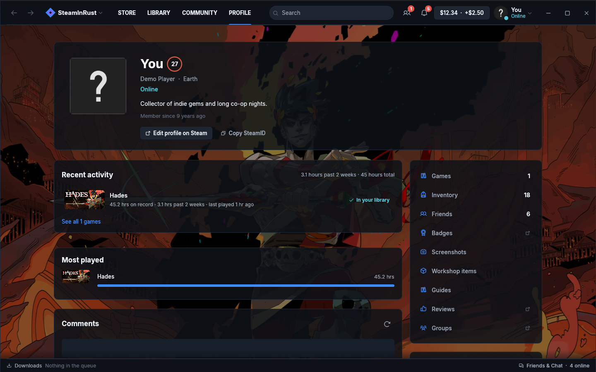

<div align="center">


# SteamInRust

**A fast, native Steam client written from scratch in Rust.**
No embedded browser, no web views: just Steam's own protocol and a GPU‑drawn UI.

**English** · [Русский](README.ru.md)

[](https://github.com/madonchik123/SteamInRust/releases/latest)




</div>

## Why

The official Steam client is a full web browser in disguise: a dozen
`steamwebhelper` processes rendering HTML. SteamInRust talks to Steam directly
and draws everything natively, so it starts fast, stays light and still does
what you open Steam for: buy and play games, talk to friends, trade items.

## Highlights

| | |
|---|---|
| ⚡ **Native and light** | One Rust process, no Chromium. The UI is drawn on the GPU with [egui](https://github.com/emilk/egui). |
| 🛒 **The whole store** | Front page, search, tag browsing with filters, wishlist, cart, gifts, price history. Game pages with **trailers playing natively** (HLS streaming, sound, full screen), clickable developers, publishers and tags. |
| 📚 **Library** | Collections (your Steam Favorites and Hidden imported), filters by genre, features and Steam Deck status, Properties, DLC, launch options, verify files, desktop shortcuts. |
| ⬇️ **Downloads** | Its own depot downloader with a queue, auto-updates, bandwidth limits and every Steam download region, plus partner CDNs, sorted by measured speed. |
| ☁️ **Steam Cloud** | Per-game toggle, sync before you play and after you quit, conflict handling with local backups. |
| 🎮 **Steam features in games** | Games without anti-cheat get achievements, stats, friends and multiplayer sign-in from SteamInRust's own `steamclient`. Games with VAC, EAC or BattlEye start through the official client, silently, so their anti-cheat runs as intended. |
| 🧭 **Shift+Tab overlay** | Game overview, achievements, friends, chat, notes, guides and discussions in windows you can **pin over the game** with adjustable opacity. Nothing is injected into the game. |
| 👥 **Community** | Friends with real game names and rich presence, chat, a friends window, profiles with badges, comments and showcases, community hubs, Workshop pages, guides and discussions, all native. |
| 💰 **Inventory & Market** | Every game's inventory with the game's own filters and rarity colors, market prices, order book, price chart, quick sell with Steam's real fees, your listings. |
| 🔔 **Notifications** | All Steam notification types with game art or avatars, toasts, a styled tray menu. |
| 🧩 **Plugins** | Extend the client with sandboxed [Rhai](https://rhai.rs) scripts: custom pages, notifications, automations. Every permission is approved by you. |
| 🌍 **English and Russian** | Picked from your system language; every string is translated. |
| 🔄 **Auto-updates** | New versions download in the background, are verified with SHA-256 and install on restart. |

## Screenshots

<table>
  <tr>
    <td></td>
    <td></td>
  </tr>
  <tr>
    <td align="center">Library</td>
    <td align="center">Inventory &amp; Market</td>
  </tr>
  <tr>
    <td></td>
    <td></td>
  </tr>
  <tr>
    <td align="center">Profile</td>
    <td align="center">Store</td>
  </tr>
</table>

## Install

1. Download **`SteamInRust-Setup-<version>.exe`** from the [latest release](https://github.com/madonchik123/SteamInRust/releases/latest).
2. Run it. It installs for your user only (no administrator rights) into
   `%LOCALAPPDATA%\Programs\SteamInRust`, with Start menu and desktop shortcuts.
3. Sign in with your Steam account: password with Steam Guard, or scan the QR
   code with the Steam Mobile app.

Prefer no installer? Grab the **portable zip** instead (it doesn't update itself).
Uninstall from Windows **Settings → Apps**, or run `uninstall.exe` in the install folder.

> Windows may show a SmartScreen warning for new, unsigned apps: choose
> **More info → Run anyway**. Checksums for every file are in `SHA256SUMS.txt`.

## Plugins

A plugin is a folder with a manifest and a script. Here's a page that counts your online friends:

```toml
# plugins/friends-online/plugin.toml
id = "friends-online"
name = "Friends online"
version = "1.0.0"
permissions = ["friends.read"]

[page]
title = "Friends online"
icon = "users"
```

```rust
// plugins/friends-online/main.rhai
fn page() {
    let online = friends().filter(|f| f.status != "Offline");
    [
        #{ type: "heading", text: "Friends online" },
        #{ type: "stat", label: "Right now", value: online.len().to_string() },
    ]
}
```

Scripts can't touch files, the network or other programs, only the API they were
granted. See [`crates/plugins`](crates/plugins/src/lib.rs) for the full API and
[`crates/plugins/examples`](crates/plugins/examples) for more.

## FAQ

**Is this official?** No. SteamInRust is an independent project, not affiliated with Valve.

**Can I get banned?** SteamInRust signs in the way the official client and the
Steam Mobile app do, and it never touches anti-cheat: games that use VAC, EAC
or BattlEye always run through the official Steam client. Your games, items
and purchases stay on your Steam account.

**Where are my sign-in details kept?** On your PC only, in your user's app data folder,
and they're only ever sent to Steam. Besides Steam, the app only contacts GitHub
(to check for updates) and, if you add your own key, IsThereAnyDeal (price
history). There's no telemetry.

**Can I buy games?** Yes: the cart is the same as on the website, and payment
happens on Steam's website, which Steam requires.

**Linux or macOS?** Not yet: today SteamInRust is built and tested on Windows.

More detail: [feature status](docs/parity.md) · [how games get Steam features](docs/steam-compatibility.md).

## Build from source

You need [Rust](https://rustup.rs) and MinGW-w64 (the project uses the GNU toolchain; see `rust-toolchain.toml`).

```bash
cargo run                  # sign in with your account
cargo run -- --demo        # sample data, no sign-in
cargo test --workspace
powershell -File tools/package.ps1   # setup + portable zip in target/package/dist
```

<details>
<summary>Project layout</summary>

```
apps/desktop     the app: shell, sign-in, overlay, tray, updater, pages (builtin/)
apps/installer   the setup, updater and uninstaller
crates/
  steamclient    Steam features for games (a steamclient.dll in Rust)
  video          native trailer player (HLS, Media Foundation, WASAPI)
  client         the engine: commands in, events out, PICS, chat, cloud, market
  net            CM connection: WebSocket, framing, jobs, service calls
  auth           sign-in: RSA password, QR, Steam Guard, refresh tokens
  depot          depot downloader
  store          store APIs (browse, reviews, tags, trailers, news)
  local          the local Steam install: libraries, manifests, verify
  plugins        sandboxed user plugins
  extensions     the page API every page implements
  i18n           translations (locales/ru.toml)
  ui             theme, fonts, widgets
  proto          Steam .proto files compiled with pure-Rust protox
  vdf, model     KeyValues parser, shared types
```
</details>

## Credits

Fonts: [Inter](https://rsms.me/inter/) (OFL) · Icons: [Phosphor](https://phosphoricons.com) (MIT) ·
Protocol definitions: [SteamTracking/Protobufs](https://github.com/SteamDatabase/Protobufs) ·
Price history: [IsThereAnyDeal](https://isthereanydeal.com) (bring your own free key).

## License

[MIT](LICENSE). Steam and the Steam logo are trademarks of Valve Corporation.
SteamInRust is not affiliated with, endorsed or sponsored by Valve.
