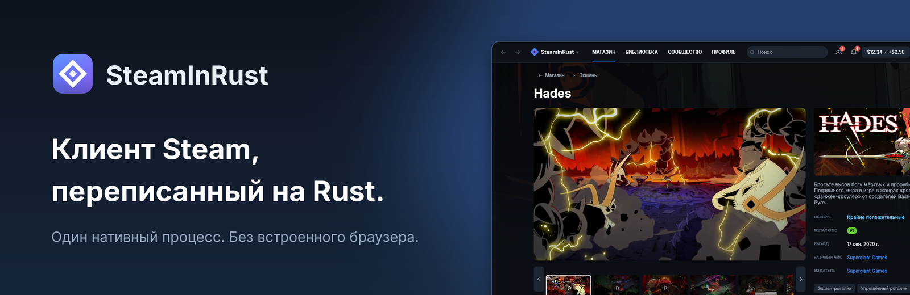
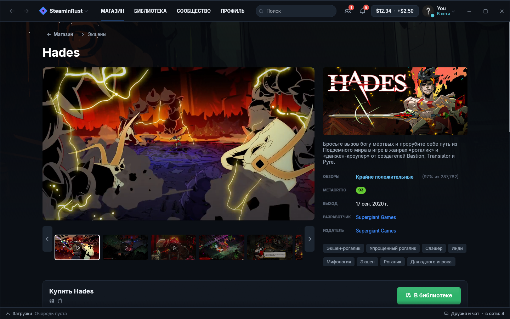
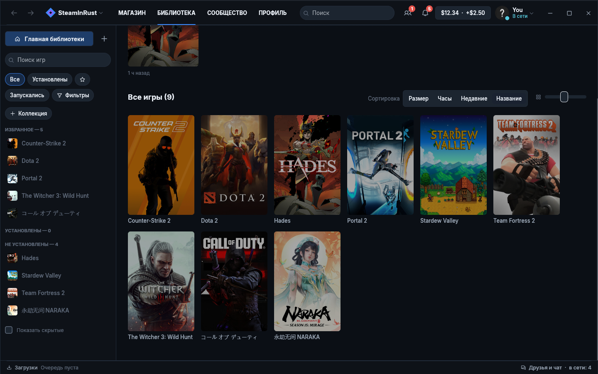
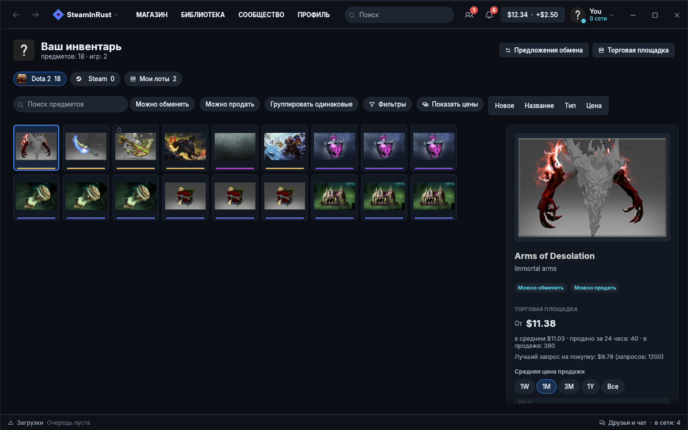
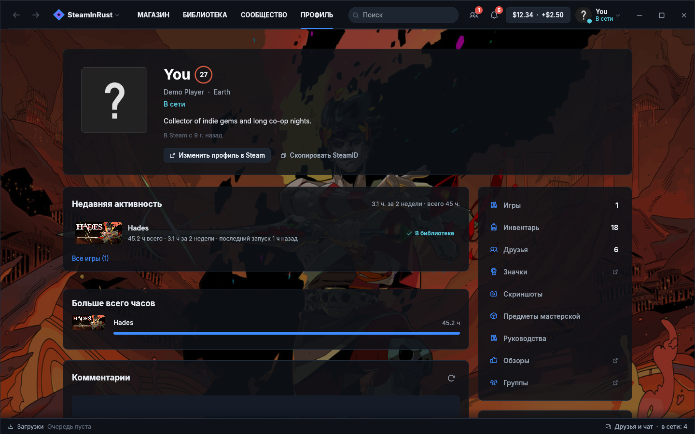
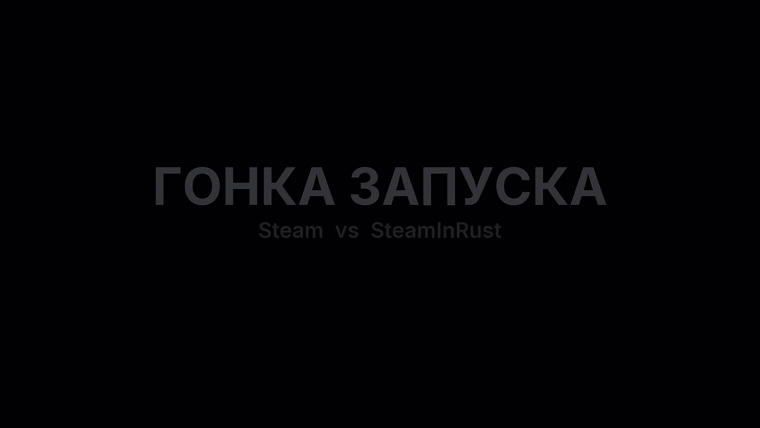

<p align="center">
  
</p>

<p align="center">
  <a href="#скачать"><b>Скачать</b></a> ·
  <a href="#производительность"><b>Замеры</b></a> ·
  <a href="docs/parity.md"><b>Что готово</b></a> ·
  <a href="docs/steam-compatibility.md"><b>Игры и античиты</b></a> ·
  <a href="CONTRIBUTING.md"><b>Участие</b></a> ·
  <a href="README.md"><b>English</b></a>
</p>

<p align="center">
  <a href="https://github.com/madonchik123/SteamInRust/releases/latest"></a>
  <a href="https://github.com/madonchik123/SteamInRust/actions/workflows/ci.yml"></a>
  
  
</p>

# SteamInRust

**Десктопный клиент Steam, переписанный на Rust.** Магазин, библиотека,
загрузки, друзья, чат, инвентарь, Торговая площадка, Steam Cloud и оверлей по
Shift+Tab в одном нативном процессе без встроенного браузера. Он входит в ваш
аккаунт Steam и работает с серверами Steam напрямую. Бесплатный, с открытым
кодом (MIT), неофициальный.

Официальный клиент сделан на Chromium: десяток процессов `steamwebhelper.exe`
рисуют веб-страницы. SteamInRust рисует всё сам на видеокарте с помощью
[egui](https://github.com/emilk/egui), поэтому запускается примерно за две
секунды и в простое занимает около четверти гигабайта.

<p align="center">
  
</p>

## Что уже работает

Всё ниже есть в текущем релизе. Подробно по разделам:
[что готово](docs/parity.md) (на английском).

- **Магазин.** Главная, поиск, метки с фильтрами, список желаемого и корзина.
  Трейлеры на страницах игр играют прямо в приложении. Цены показаны в валюте
  вашего кошелька, игры, которые у вас уже есть, отмечены. Игру можно подарить,
  даже если она у вас есть, и SteamInRust заранее проверит, доставит ли Steam
  подарок в регион друга. Оплата проходит на сайте Steam, так требует Steam.
- **Библиотека.** Все ваши игры, коллекции (вместе с «Избранным» и «Скрытым»
  из Steam), сторонние игры, фильтры, достижения и полные свойства игры:
  параметры запуска, язык, бета-версии, DLC, Steam Cloud, проверка файлов.
- **Загрузки.** Собственный загрузчик депо: очередь, пауза и продолжение,
  загрузка переживает перезапуск. Скорость сети и диска показаны отдельно,
  регион загрузки выбирается по замеренной скорости.
- **Друзья и чат.** Статус в реальном времени с игрой и rich presence, чат с
  историей, отдельное окно друзей. По правому клику можно присоединиться к
  игре друга или посмотреть его сервер.
- **Сообщество.** Профили, комментарии, центры сообщества игр, страницы
  Мастерской, руководства и обсуждения, всё внутри приложения.
- **Мастерская.** Мастерская игры с её собственными фильтрами по меткам.
  Подписка сразу загружает предмет, а недостающие и обновлённые предметы
  загружаются перед запуском игры, как в Steam.
- **Аккаунт.** Данные аккаунта, история покупок, лицензии и семья Steam на
  собственных страницах.
- **Инвентарь и Торговая площадка.** Инвентарь каждой игры, цены, стакан
  заявок и график. Продажа с настоящими комиссиями Steam; подтверждение в
  мобильном приложении Steam.
- **Steam Cloud.** Синхронизация перед игрой и после выхода, конфликты с
  локальными копиями, сохранения из офлайна выгружаются, когда сеть вернётся.
- **Игры.** Игры без античита получают достижения, статистику, облачные
  сохранения, лобби, P2P, Мастерскую, инвентарь, браузер серверов, скриншоты и
  Steam Input от собственного `steamclient` SteamInRust, включая 32-битные
  игры. Старые сетевые игры (например, Human Fall Flat) играют с друзьями и
  незнакомцами из официального клиента. Игры с VAC, Easy Anti-Cheat или BattlEye всегда запускаются
  через официальный клиент, незаметно, чтобы античит работал как задумано
  ([как это устроено](docs/steam-compatibility.md)).
- **Оверлей.** Shift+Tab в запущенной игре открывает друзей, чат,
  достижения, руководства и заметки. Как и в Steam, он рисуется внутри игры
  (игры на D3D11), поэтому работает и в полноэкранном режиме. Любое окно можно
  закрепить поверх игры.
- **Офлайн-режим.** Работает как в Steam. Если связь пропала, SteamInRust
  переподключается, не выходя из аккаунта, и запущенные игры продолжают работать.
- **Плагины.** Небольшие скрипты на [Rhai](https://rhai.rs) добавляют страницы,
  уведомления и автоматизацию, только с теми разрешениями, которые вы дали.
- **Русский и английский**, по языку системы.

<table>
  <tr>
    <td width="50%"></td>
    <td width="50%"></td>
  </tr>
  <tr>
    <td width="50%"></td>
    <td width="50%"></td>
  </tr>
</table>

<sub>Скриншоты сделаны в режиме <code>--demo</code> с тестовыми данными аккаунта.</sub>

## Производительность

**SteamInRust открывает окно примерно в 4 раза быстрее Steam и занимает
меньше четверти памяти** на том же ПК, с тем же аккаунтом и сетью. Замерено
8 ноября 2026 года на Ryzen 5 5600 с 16 ГБ памяти, Windows 11: SteamInRust
0.4.0 против Steam 11.15.70.27. Оба клиента открывались на библиотеке. Каждое
число — типичный результат из 5 запусков:

| | Steam | SteamInRust |
| --- | ---: | ---: |
| Запуск → главное окно | 9,4 с | 2,4 с |
| Запуск → библиотека полностью отрисована | 19,2 с | 10,0 с |
| Память в простое (private bytes) | 1126 МБ | 255 МБ |
| Процессор в простое | 7,5 % ядра | 0,13 % |
| Процессов | 8 | 1 |
| Размер программы | 1083 МБ | 27,2 МБ |
| Открыть магазин | 1,22 с | 0,56 с |
| Открыть страницу игры в библиотеке | 0,85 с | 0,06 с |
| Открыть «Друзья и чат» | 1,32 с | 0,05 с |

Большая часть времени до полностью отрисованной библиотеки у SteamInRust
уходит на загрузку обложек из сети. Когда обложки уже в кеше на диске (тёплый
запуск), получилось 7,2 с. Сам список игр появляется примерно через 1 с после
запуска: SteamInRust показывает библиотеку с прошлого входа, пока Steam
присылает актуальную. Методика, разброс и что не учитывалось:
[docs/benchmarks.md](docs/benchmarks.md) (на английском).

## Скачать

Берите в [последнем релизе](https://github.com/madonchik123/SteamInRust/releases/latest):

| Файл | Что это |
| --- | --- |
| `SteamInRust-Setup-<версия>.exe` | Установщик. Ставит только для вашего пользователя, без прав администратора, в `%LOCALAPPDATA%\Programs\SteamInRust`, и обновляется сам |
| `SteamInRust-<версия>-portable.zip` | То же приложение без установщика. Само не обновляется |
| `SHA256SUMS.txt` | Контрольные суммы обоих файлов |

Нужны Windows 10 или 11 (64-бит) и аккаунт Steam. Войти можно паролем со Steam
Guard или по QR-коду из мобильного приложения Steam. SmartScreen может
предупредить о новом неподписанном приложении: **Подробнее → Выполнить в любом
случае**. Удалить можно в **Параметры → Приложения**.

## Это безопасно?

- **Аккаунт.** SteamInRust входит так же, как официальный клиент и мобильное
  приложение Steam. Данные входа хранятся только на вашем ПК, в папке данных
  приложения вашего пользователя, и отправляются только в Steam.
- **Античиты.** SteamInRust никогда не трогает античиты. Игры с ними всегда
  запускаются через клиент Valve.
- **Другие соединения.** Кроме Steam, приложение обращается только к GitHub
  (за обновлениями) и к сервису курсов валют (когда вы проверяете регион
  подарка). Если вы добавите свой ключ, ещё к IsThereAnyDeal (история цен).
  Телеметрии нет.
- **Неофициальный.** SteamInRust не сделан и не одобрен Valve.

## Плагины

Плагин — это папка с описанием и скриптом. Этот добавляет страницу, которая
считает друзей в сети:

```toml
# plugins/friends-online/plugin.toml
id = "friends-online"
name = "Друзья в сети"
version = "1.0.0"
permissions = ["friends.read"]

[page]
title = "Друзья в сети"
icon = "users"
```

```rust
// plugins/friends-online/main.rhai
fn page() {
    let online = friends().filter(|f| f.status != "Offline");
    [
        #{ type: "heading", text: "Друзья в сети" },
        #{ type: "stat", label: "Сейчас", value: online.len().to_string() },
    ]
}
```

Скрипты не имеют доступа к файлам, сети и другим программам, только к
разрешённому API. API описан в [`crates/plugins`](crates/plugins/src/lib.rs),
ещё примеры в [`crates/plugins/examples`](crates/plugins/examples).

## Сборка из исходников

Нужны [Rust](https://rustup.rs) и MinGW-w64. Проект использует GNU-тулчейн
(см. `rust-toolchain.toml`).

```sh
git clone https://github.com/madonchik123/SteamInRust.git
cd SteamInRust
cargo run                  # вход в ваш аккаунт
cargo run -- --demo        # тестовые данные, без входа
cargo test --workspace
cargo xtask steamclient32   # DLL для 32-битных игр (нужен 32-битный MinGW)
cargo xtask package        # установщик и portable-архив в target/package/dist
```

<details>
<summary>Как устроен код</summary>

```
apps/desktop     приложение: окно, вход, оверлей, трей, обновления, страницы (builtin/)
apps/installer   установщик, обновление и удаление
xtask            сборка релиза (cargo xtask package)
crates/
  client         ядро: команды на вход, события на выход; PICS, чат, облако, площадка
  net            соединение со Steam: WebSocket, кадры, задачи, вызовы сервисов
  auth           вход: пароль через RSA, QR, Steam Guard, refresh-токены
  depot          загрузчик депо
  steamclient    DLL steamclient, которую загружают игры
  store          API магазина: каталог, обзоры, метки, трейлеры, новости
  video          плеер трейлеров: HLS, Media Foundation, WASAPI
  local          папки Steam на диске: библиотеки, манифесты, проверка
  plugins        плагины на Rhai
  extensions     интерфейс, который реализует каждая страница
  i18n           переводы (locales/ru.toml)
  ui             тема, шрифты, виджеты
  proto          .proto-файлы Steam, компилируются через protox
  vdf, model     парсер KeyValues, общие типы
```
</details>

## Участие

Задачи и пул-реквесты приветствуются. Сначала прочитайте
[CONTRIBUTING.md](CONTRIBUTING.md). Заголовки пул-реквестов пишутся по
Conventional Commits (`feat: …`, `fix: …`): из них собираются релизы и список
изменений. Что ещё не сделано, видно в [docs/parity.md](docs/parity.md).

## Состояние проекта

| Раздел | Оценка |
| --- | ---: |
| Вход и аккаунты | 0,75 |
| Офлайн-режим и переподключение | 1 |
| Библиотека | 0,75 |
| Загрузки и установка | 0,75 |
| Магазин | 0,75 |
| Друзья и чат | 0,75 |
| Сообщество | 0,5 |
| Инвентарь и Торговая площадка | 0,75 |
| Steam Cloud | 1 |
| Функции Steam в играх | 0,75 |
| Оверлей Shift+Tab | 0,75 |
| Уведомления и трей | 1 |
| Настройки, языки, обновления | 0,75 |
| Big Picture, Remote Play | 0 |

0 — не начато, 1 — готово. Чего не хватает в каждом разделе:
[docs/parity.md](docs/parity.md).

## Благодарности

Шрифты: [Inter](https://rsms.me/inter/) (OFL). Иконки: [Phosphor](https://phosphoricons.com) (MIT).
Описания протокола: [SteamDatabase/Protobufs](https://github.com/SteamDatabase/Protobufs).
История цен: [IsThereAnyDeal](https://isthereanydeal.com).

## Лицензия

[MIT](LICENSE). Steam и логотип Steam — товарные знаки Valve Corporation.
SteamInRust не связан с Valve и не одобрен ею.
