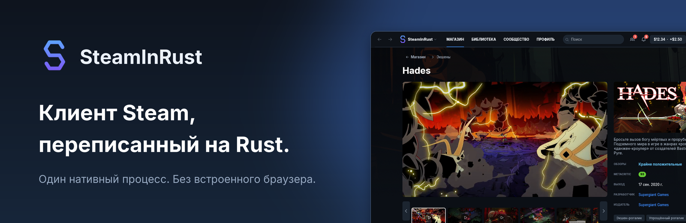
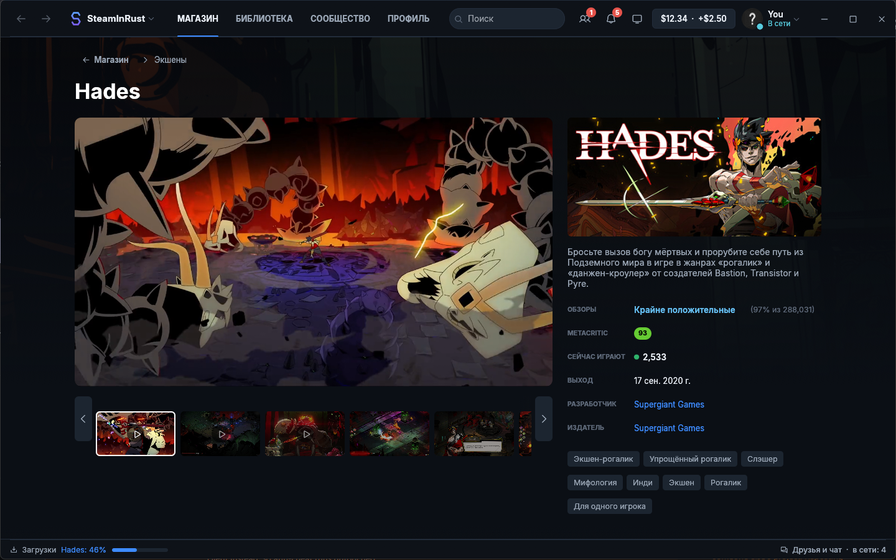
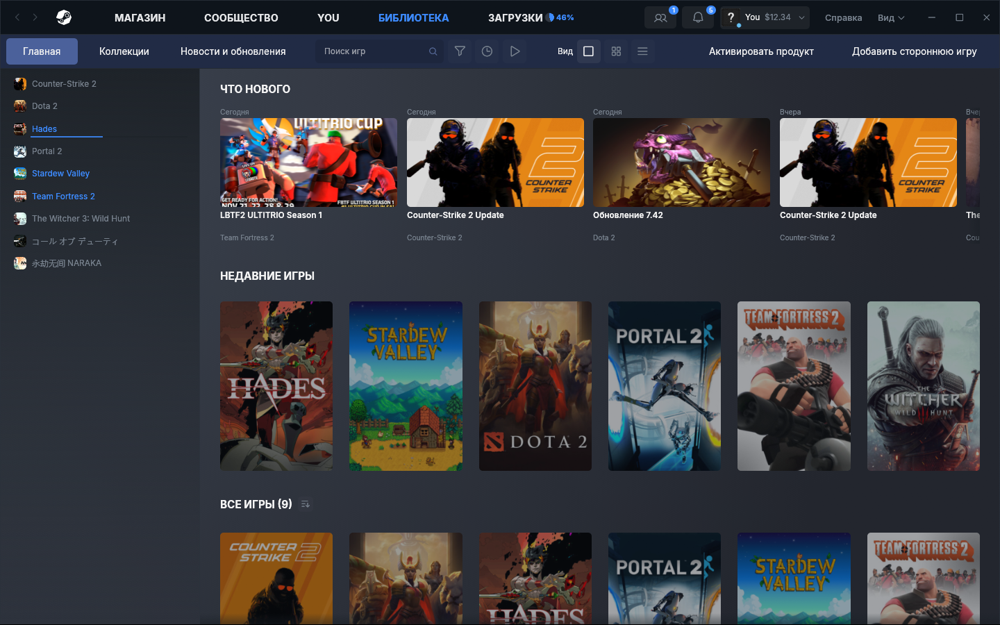
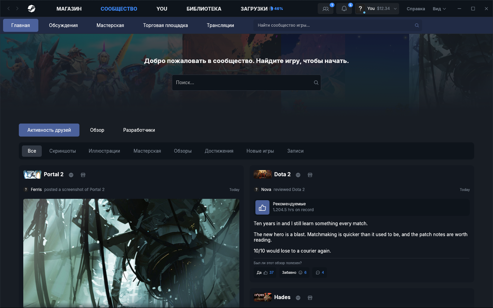
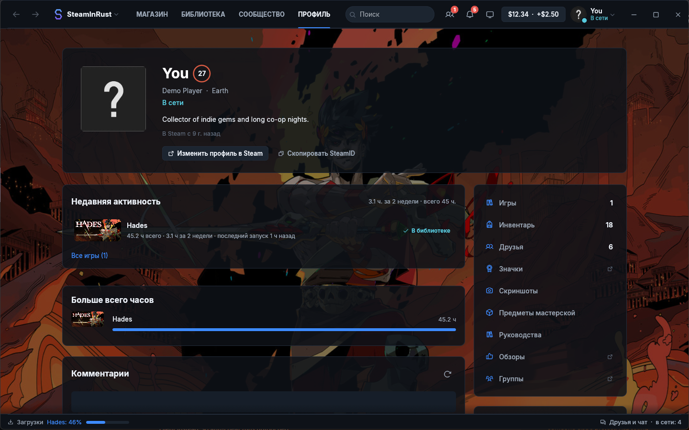
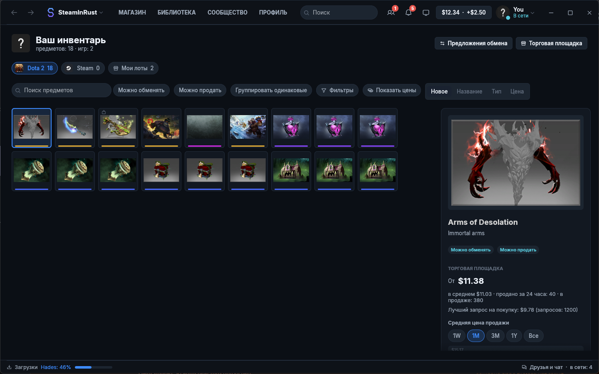
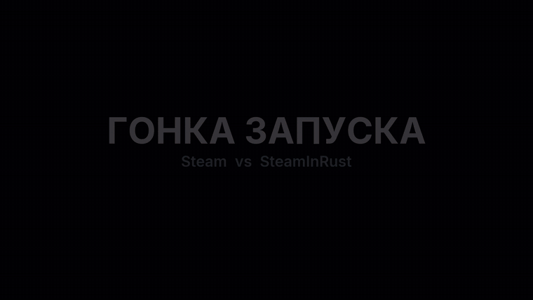

<p align="center">
  
</p>

<p align="center">
  <a href="#скриншоты"><b>Скриншоты</b></a> ·
  <a href="#скачать"><b>Скачать</b></a> ·
  <a href="#производительность"><b>Замеры</b></a> ·
  <a href="#это-безопасно"><b>Безопасность</b></a> ·
  <a href="docs/parity.md"><b>Что готово</b></a> ·
  <a href="CHANGELOG.md"><b>Изменения</b></a> ·
  <a href="https://boosty.to/32tq"><b>Поддержать</b></a> ·
  <a href="README.md"><b>English</b></a>
</p>

<p align="center">
  <a href="https://github.com/madonchik123/SteamInRust/releases/latest"></a>
  <a href="https://github.com/madonchik123/SteamInRust/actions/workflows/ci.yml"></a>
  
  
</p>

<p align="center">
  
</p>

# SteamInRust

**Десктопный клиент Steam, переписанный на Rust.** Магазин, библиотека,
загрузки, друзья, чат, инвентарь, Торговая площадка, Steam Cloud и оверлей по
Shift+Tab в одном нативном процессе без встроенного браузера. Он входит в ваш
аккаунт Steam и работает с серверами Steam напрямую.

- **Быстрый и лёгкий:** окно появляется примерно через две с половиной
  секунды, а в простое он занимает около 115 МБ в одном процессе. Официальный
  клиент сделан на Chromium, это десяток процессов `steamwebhelper.exe`;
  SteamInRust рисует всё сам на видеокарте с помощью
  [egui](https://github.com/emilk/egui).
- **Ваши игры как есть:** обычный аккаунт и библиотека Steam. Игры с
  античитом по-прежнему запускаются через официальный клиент, для них ничего
  не меняется.
- **Windows и Mac:** Windows 10 и 11, а также macOS 11 и новее, где игры для
  Windows запускаются через Steam Play с CrossOver или Wine.
- **Свой внешний вид:** основан на [Steam Redesign](https://www.figma.com/community/file/1302616100790619521/steam-redesign)
  от **Juxtopposed**. Весь внешний вид — это тема, поэтому прежний остался как
  **Classic**, а свою тему можно сделать самому.

Бесплатный, с открытым кодом (MIT), неофициальный.

## Скриншоты

<table>
  <tr>
    <td width="50%">
      
      <p align="center"><sub><b>Библиотека</b> — что нового, недавние игры, коллекции</sub></p>
    </td>
    <td width="50%">
      
      <p align="center"><sub><b>Сообщество</b> — скриншоты, обзоры и достижения друзей</sub></p>
    </td>
  </tr>
  <tr>
    <td width="50%">
      
      <p align="center"><sub><b>Профили</b> — фоны, значки и витрины</sub></p>
    </td>
    <td width="50%">
      
      <p align="center"><sub><b>Инвентарь</b> — цены площадки и график</sub></p>
    </td>
  </tr>
  <tr>
    <td width="50%">
      
      <p align="center"><sub><b>Запуск</b> — SteamInRust и Steam запускаются рядом</sub></p>
    </td>
    <td width="50%">
      
      <p align="center"><sub><b>Big Picture</b> — режим для телевизора, управление с клавиатуры</sub></p>
    </td>
  </tr>
</table>

<sub>Скриншоты сделаны в режиме <code>--demo</code> с тестовыми данными аккаунта, в теме SteamInRust.</sub>

## Что уже работает

Всё ниже есть в текущем релизе. Подробно по разделам:
[что готово](docs/parity.md) (на английском).

- **Магазин.** Главная, поиск, метки с фильтрами, список желаемого и корзина.
  Трейлеры на страницах игр играют прямо в приложении. Цены показаны в валюте
  вашего кошелька, игры, которые у вас уже есть, отмечены. Игру можно подарить,
  даже если она у вас есть, и SteamInRust заранее проверит, доставит ли Steam
  подарок в регион друга. Оплата проходит на сайте Steam, так требует Steam.
  Поиск подсказывает игры, пока вы печатаете, а список желаемого можно
  упорядочить перетаскиванием. Страницы наборов и комплектов, кураторы, на
  которых можно подписаться, и свои обзоры. А ещё лента рекомендаций и магазин
  очков.
- **Библиотека.** Все ваши игры, коллекции (вместе с «Избранным» и «Скрытым»
  из Steam и динамическими, которые сами собираются по фильтрам), достижения и
  полные свойства игры: параметры запуска, язык, бета-версии, DLC, Steam Cloud,
  проверка файлов и перенос игры в другую папку библиотеки. У сторонних игр такое
  же меню и страница, как у игр Steam, а любой игре можно задать свои картинки
  (значок, обложку, фон, логотип), как в Steam.
- **Загрузки.** Собственный загрузчик депо: очередь, пауза и продолжение,
  загрузка переживает перезапуск. Скорость сети и диска показаны отдельно,
  регион загрузки выбирается по замеренной скорости. На Mac можно выбрать
  версию для macOS или для Windows (Steam Play), у каждой виден размер.
- **Друзья и чат.** Статус в реальном времени с игрой и rich presence, чат с
  историей и групповые чаты в одном окне «Друзья и чат», как в Steam: открытый
  чат стоит рядом со списком друзей. Смайлики Steam и эмодзи с выбором,
  команды (`/me`, `/code`, `/spoiler`, `/random`, `/store`…), реакции,
  карточки ссылок и картинки. Голосовой чат: звонки друзьям и голосовые каналы
  в группах, с режимом «нажми и говори». Групповыми чатами можно управлять как в Steam:
  уведомления, ссылки-приглашения, каналы, роли, баны. По правому клику можно
  присоединиться к игре друга или посмотреть его сервер.
- **Сообщество.** Главная сообщества построена вокруг игроков: активность
  друзей (скриншоты, иллюстрации, обзоры, достижения), «Обзор» и новости от
  разработчиков ваших игр, и можно опубликовать статус для друзей. А ещё
  центры сообщества игр, страницы Мастерской, руководства и обсуждения (можно
  начать своё), трансляции, менеджер ваших скриншотов и группы, в которые можно
  вступать, выходить и отвечать на приглашения, всё внутри приложения.
- **Профили.** Профили с фонами (анимированные проигрываются), темами профиля
  Steam, значками, витринами и комментариями. Добавить в друзья можно прямо из
  профиля. Свой профиль редактируется как в Steam: аватар и рамка, фон,
  мини-профиль, тема и все настройки приватности.
- **Мастерская.** Мастерская игры с её собственными фильтрами по меткам.
  Подписка сразу загружает предмет, а недостающие и обновлённые предметы
  загружаются перед запуском игры, как в Steam.
- **Аккаунт.** Данные аккаунта, история покупок, лицензии и семья Steam
  (пригласить, принять, исключить, выйти) на собственных страницах.
- **Инвентарь, Торговая площадка и обмен.** Инвентарь каждой игры, цены,
  стакан заявок и график. Продажа с настоящими комиссиями Steam; подтверждение
  в мобильном приложении Steam. Покупка, заявки на покупку, самоцветы, наборы
  карточек и ожидающие подарки тоже есть в приложении. Предложения обмена в
  приложении: видно, сколько стоит каждая сторона, можно принять, отклонить,
  сделать встречное или собрать новое из обоих инвентарей с фильтрами,
  сортировкой и ценами.
- **Steam Cloud.** Синхронизация перед игрой и после выхода, конфликты с
  локальными копиями, сохранения из офлайна выгружаются, когда сеть вернётся.
- **Игры.** Игры без античита получают достижения, статистику, облачные
  сохранения, лобби, P2P, Мастерскую, инвентарь, браузер серверов, скриншоты и
  Steam Input от собственного `steamclient` SteamInRust, включая 32-битные
  игры. Старые сетевые игры (например, Human Fall Flat) играют с друзьями и
  незнакомцами из официального клиента. Игры с VAC, Easy Anti-Cheat или BattlEye всегда запускаются
  через официальный клиент, незаметно, чтобы античит работал как задумано
  ([как это устроено](docs/steam-compatibility.md)). На Mac игры для Windows
  запускаются через Steam Play с CrossOver или Wine
  ([как настроить](#игры-для-windows-на-mac-steam-play)). Из приложения можно
  запустить и свой игровой сервер.
- **Оверлей.** Shift+Tab в запущенной игре открывает друзей, чат,
  достижения, руководства и заметки. Как и в Steam, он рисуется внутри игры
  (игры на D3D11 и D3D12), поэтому работает и в полноэкранном режиме, а игра, пока он
  открыт, не получает ввод. Открывается и кнопкой Guide на геймпаде. Любое окно
  можно закрепить поверх игры, а ещё делать скриншоты по F12 и показывать
  счётчик FPS.
- **Офлайн-режим.** Работает как в Steam. Если связь пропала, SteamInRust
  переподключается, не выходя из аккаунта, и запущенные игры продолжают работать.
- **Big Picture.** Полноэкранный режим для телевизора с управлением
  геймпадом или клавиатурой: главная, библиотека, страницы игр с трейлерами,
  установка, магазин с экранной клавиатурой, загрузки, друзья с полноэкранным
  чатом и настройки, которые меняют с дивана. Открывается из меню, кнопкой Guide
  на геймпаде или при запуске с `--bigpicture`.
- **Темы.** Тема задаёт весь внешний вид: цвета, шрифты, картинки, значки,
  вид каждого элемента и раскладку (навигация сверху или слева, с какой
  стороны список друзей, компактно или просторно). Встроены **SteamInRust**
  (новый вид) и **Classic**, а тема — это просто папка, которую можно сделать
  самому: [docs/themes.md](docs/themes.md) (на английском).
- **Плагины.** Небольшие скрипты на [Rhai](https://rhai.rs) добавляют страницы,
  кнопки на страницах игр и пункты в меню друзей. Они могут видеть библиотеку,
  достижения, загрузки, список желаемого, цены магазина, инвентарь и обмены,
  работать по таймерам и обращаться к указанным ими сайтам, только с теми
  разрешениями, которые вы дали ([docs/plugin-api.md](docs/plugin-api.md), на английском).
- **Семь языков**: русский, английский, упрощённый китайский, испанский,
  бразильский португальский, немецкий и французский, по языку системы.

## Производительность

**SteamInRust показывает окно примерно в 2,5 раза быстрее Steam, полностью
отрисовывает библиотеку примерно вдвое быстрее и занимает около девятой части
памяти** на том же ПК, с тем же аккаунтом и сетью. Замерено 19 ноября 2026 года
на Ryzen 5 5600 с 16 ГБ памяти, Windows 11: SteamInRust 0.10.0 в новом виде
против Steam 11.23.65.88. Оба клиента открывались на библиотеке. Каждое число —
средний результат из 3 запусков (не наибольший и не наименьший):

| Замер | Steam | SteamInRust | Разница |
| --- | ---: | ---: | ---: |
| Запуск → первое окно | 6,3 с | **2,5 с** | **в 2,5 раза быстрее** |
| Запуск → главное окно | 11,4 с | **2,4 с** | **в 4,8 раза быстрее** |
| Запуск → библиотека полностью отрисована | 19,1 с | **9,6 с** | **в 2 раза быстрее** |
| Память в простое (private bytes) | 1016 МБ | **115 МБ** | **в 8,8 раза меньше** |
| Процессор в простое | 7,7 % ядра | **0,08 %** | **в 96 раз меньше** |
| Процессов | 8 | **1** | **на 7 меньше** |
| Размер программы | 1084 МБ | **34,8 МБ** | **в 31 раз меньше** |
| Открыть магазин | 1,84 с | **0,81 с** | **в 2,3 раза быстрее** |
| Открыть страницу игры в библиотеке | 0,75 с | **0,03 с** | **в 25 раз быстрее** |
| Открыть «Друзья и чат» | 1,21 с | **0,05 с** | **в 24 раза быстрее** |

Время запуска — холодный старт (файлового кеша нет). По сравнению с прошлым
замером (0.7.1, до редизайна) SteamInRust занимает меньше собственной памяти
(163 → 115 МБ), а библиотека отрисовывается дольше (4,8 → 9,6 с): в этом
замере она открывалась сеткой обложек игр, которые все загружаются при запуске. Методика,
разброс, тёплый запуск и что не учитывалось:
[docs/benchmarks.md](docs/benchmarks.md) (на английском).

## Скачать

Берите в [последнем релизе](https://github.com/madonchik123/SteamInRust/releases/latest).
Нужен аккаунт Steam: войти можно паролем со Steam Guard или по QR-коду из
мобильного приложения Steam.

| Файл | Система и установка |
| --- | --- |
| `SteamInRust-Setup-<версия>.exe` | **Windows 10 или 11 (64-бит)** — установщик. Ставит только для вашего пользователя, без прав администратора, в `%LOCALAPPDATA%\Programs\SteamInRust`, и обновляется сам. Удалить можно в **Параметры → Приложения** |
| `SteamInRust-<версия>-portable.zip` | **Windows** — то же приложение без установщика. Само не обновляется |
| `SHA256SUMS.txt` | Контрольные суммы обоих файлов для Windows |
| `SteamInRust-<версия>-macos.dmg` | **macOS 11 и новее на Apple Silicon** (игры для Apple Silicon и Intel) — перетащите SteamInRust в «Программы», дальше оно обновляется само. Чтобы удалить, перетащите его в Корзину |
| `SHA256SUMS-macos.txt` | Контрольная сумма образа диска |

> **Про Windows:** SmartScreen может предупредить о новом неподписанном
> приложении. Нажмите **Подробнее → Выполнить в любом случае**.

> **Про macOS:** приложение не подписано аккаунтом разработчика Apple, поэтому
> при первом запуске macOS скажет, что не может проверить его на вредоносное
> ПО. Откройте его один раз через **правый клик → Открыть → Открыть** или
> разрешите в **Системные настройки → Конфиденциальность и безопасность → Всё
> равно открыть**. Новые игры ставятся в обычную папку Steam
> (`~/Library/Application Support/Steam`), если не выбрать другую.

### Игры для Windows на Mac (Steam Play)

Если в «Программах» есть [CrossOver](https://www.codeweavers.com/crossover) или
бесплатная [сборка Wine](https://github.com/Gcenx/macOS_Wine_builds), игры,
у которых есть только версия для Windows, ставятся и запускаются как любые
другие: их версия для Windows работает через Wine, а достижения и облачные
сохранения идут через SteamInRust.

- Инструмент по умолчанию выбирается в **Настройки → Совместимость**, а для
  отдельной игры его можно задать в **Свойства → Совместимость** (так же можно
  поставить версию для Windows у игры, у которой есть версия для Mac).
- Если нет ни CrossOver, ни Wine, страница игры только для Windows предложит
  установить Wine (бесплатная загрузка 225 МБ, проверяется перед
  использованием).
- Игры с античитом (VAC, Easy Anti-Cheat, BattlEye…) на Mac не запускаются и
  прямо об этом говорят.

## Это безопасно?

### А мой аккаунт?

SteamInRust входит так же, как официальный клиент и мобильное приложение
Steam. Данные входа хранятся только на вашем ПК, в папке данных приложения
вашего пользователя, и отправляются только в Steam.

### А античиты?

SteamInRust никогда не трогает античиты. Игры с ними всегда запускаются через
клиент Valve.

### С чем ещё он соединяется?

Кроме Steam, приложение обращается только к GitHub (за обновлениями) и к
сервису курсов валют (когда вы проверяете регион подарка). Если вы добавите
свой ключ, ещё к IsThereAnyDeal (история цен). Телеметрии нет.

### Это официальный клиент?

Нет. SteamInRust не сделан и не одобрен Valve.

## Плагины

Плагин — это папка с описанием и скриптом. Этот добавляет страницу, которая
считает друзей в сети:

```toml
# plugins/friends-online/plugin.toml
id = "friends-online"
name = "Друзья в сети"
version = "1.0.0"
permissions = ["friends.read"]

[page]
title = "Друзья в сети"
icon = "users"
```

```rust
// plugins/friends-online/main.rhai
fn page() {
    let online = friends().filter(|f| f.status != "Offline");
    [
        #{ type: "heading", text: "Друзья в сети" },
        #{ type: "stat", label: "Сейчас", value: online.len().to_string() },
    ]
}
```

- **В песочнице:** скрипты не имеют доступа к файлам и другим программам,
  только к разрешённому API.
- **Сеть только по разрешению:** плагину нужны `network` и список `hosts` в
  манифесте (только https и никогда к вашему компьютеру или локальной сети),
  который вы видите перед включением.
- **Что они умеют:** работать по таймерам, добавлять кнопки на страницы игр и
  пункты в меню друзей, запускать установленные игры, видеть библиотеку и
  достижения. Следить за загрузками и управлять ими, читать страницы и цены
  магазина, оценивать инвентарь и предложения обмена (принять или отправить
  обмен можете только вы). На своей странице показывать поля ввода,
  переключатели, таблицы и картинки.

API описан в [`docs/plugin-api.md`](docs/plugin-api.md) (на английском),
примеры в [`crates/plugins/examples`](crates/plugins/examples) (Wishlist Sales
раз в час проверяет цены из списка желаемого и сообщает о скидках; Trade Helper
говорит, сколько стоит новое предложение обмена).

## Состояние проекта

**0** не начато · **0,25** начато · **0,5** можно пользоваться, многого нет ·
**0,75** почти готово · **1** готово. Чего не хватает в каждом разделе:
[docs/parity.md](docs/parity.md) (на английском).

| Раздел | Оценка |
| --- | ---: |
| Вход и аккаунты | 0,75 |
| Офлайн-режим и переподключение | 1 |
| Библиотека | 0,75 |
| Загрузки и установка | 1 |
| Магазин | 1 |
| Друзья и чат | 0,75 |
| Сообщество | 0,75 |
| Инвентарь и Торговая площадка | 0,75 |
| Steam Cloud | 1 |
| Функции Steam в играх | 0,75 |
| Оверлей Shift+Tab | 0,75 |
| Уведомления и трей | 1 |
| Настройки, языки, обновления | 0,75 |
| Big Picture | 0,75 |
| Remote Play | 0 |

## Сборка из исходников

Нужны [Rust](https://rustup.rs) и [CMake](https://cmake.org) (им собирается
голосовой кодек Opus). На Windows ещё MinGW-w64: там проект использует
GNU-тулчейн (см. `rust-toolchain.toml`).

```sh
git clone https://github.com/madonchik123/SteamInRust.git
cd SteamInRust
cargo run                   # вход в ваш аккаунт
cargo run -- --demo         # тестовые данные, без входа
cargo test --workspace
cargo xtask steamclient32   # DLL для 32-битных игр (нужен 32-битный MinGW)
cargo xtask package         # установщик и portable-архив (на macOS — .dmg) в target/package/dist
```

На macOS установите инструменты командной строки Xcode
(`xcode-select --install`) и один раз попросите rustup использовать в папке
проекта тулчейн самого Mac:

```sh
rustup override set stable
cargo xtask steamclient-mac  # steamclient, который загружают игры (для Apple и Intel)
cargo xtask steamclient-win  # Steam Play: steamclient для Windows (нужен brew install mingw-w64)
```

<details>
<summary>Как устроен код</summary>

```
apps/desktop     приложение: окно, вход, оверлей, трей, обновления, страницы (builtin/)
apps/installer   установщик, обновление и удаление
xtask            сборка релиза (cargo xtask package)
crates/
  client         ядро: команды на вход, события на выход; PICS, чат, облако, площадка
  net            соединение со Steam: WebSocket, кадры, задачи, вызовы сервисов
  auth           вход: пароль через RSA, QR, Steam Guard, refresh-токены
  depot          загрузчик депо
  steamclient    DLL steamclient, которую загружают игры
  store          API магазина: каталог, обзоры, метки, трейлеры, новости
  video          плеер трейлеров: HLS; Media Foundation и WASAPI (Windows),
                 VideoToolbox и AudioToolbox (macOS)
  local          папки Steam на диске: библиотеки, манифесты, проверка
  plugins        плагины на Rhai
  extensions     интерфейс, который реализует каждая страница
  i18n           переводы (locales/ru.toml)
  ui             темы (пакеты в ui/themes), шрифты, общие элементы
  proto          .proto-файлы Steam, компилируются через protox
  vdf, model     парсер KeyValues, общие типы
```
</details>

## Поддержать проект

SteamInRust бесплатный, без рекламы и телеметрии. Если он вам полезен,
поддержать разработку можно на [Boosty](https://boosty.to/32tq).

## Участие

Задачи и пул-реквесты приветствуются. Сначала прочитайте
[CONTRIBUTING.md](CONTRIBUTING.md). Заголовки пул-реквестов пишутся по
Conventional Commits (`feat: …`, `fix: …`): из них собираются релизы и список
изменений. Что ещё не сделано, видно в [docs/parity.md](docs/parity.md).

## Благодарности

- **Дизайн:** [Steam Redesign](https://www.figma.com/community/file/1302616100790619521/steam-redesign)
  от **Juxtopposed**, опубликован в Figma Community
  ([видео о нём](https://youtu.be/cDY2p1CTkPo)). Тема SteamInRust по умолчанию
  следует ему; код, система тем и любые ошибки переноса — наши.
- **Шрифты:** [Inter](https://rsms.me/inter/) (OFL). **Иконки:**
  [Phosphor](https://phosphoricons.com) (MIT).
- **Описания протокола:** [SteamDatabase/Protobufs](https://github.com/SteamDatabase/Protobufs).
- **История цен:** [IsThereAnyDeal](https://isthereanydeal.com).

## Лицензия

[MIT](LICENSE). Steam — товарный знак Valve Corporation. SteamInRust не связан
с Valve и не одобрен ею.
